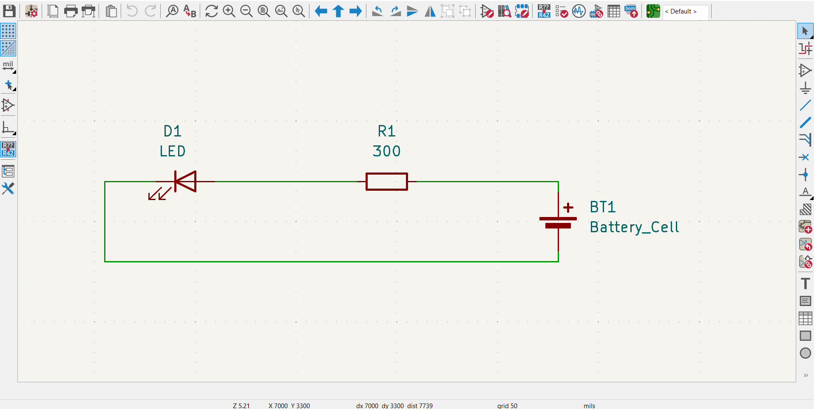
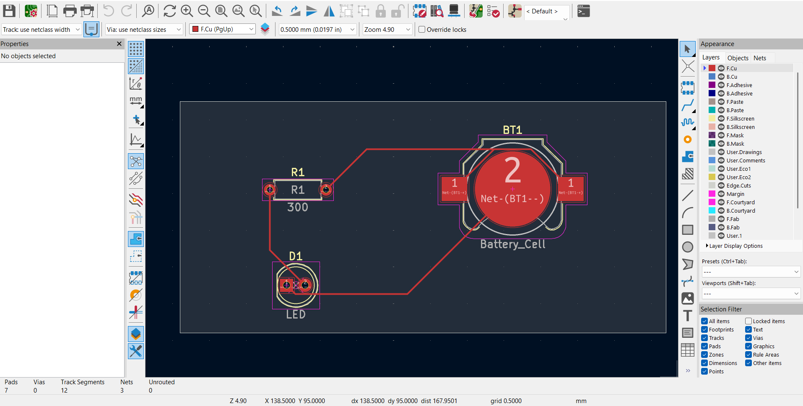
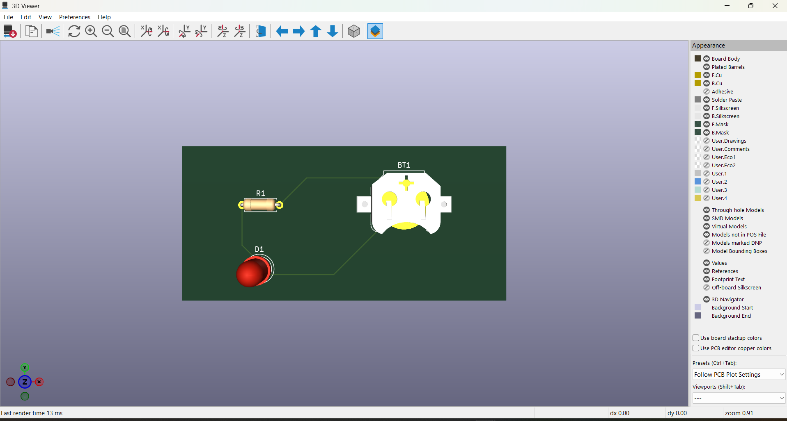

# Two-LED-PCB

## Overview
A simple battery-powered LED circuit with a current-limiting resistor, designed in KiCad.

## Project Structure
- `hardware/` — KiCad schematic, PCB layout, and project files
- `gerbers/` — Gerber fabrication files, drill files, and Gerber job file
- `images/` — Schematic, PCB layout, and 3D board screenshots

## Design Tools
- KiCad 10.0.6

## Manufacturing
The `gerbers/` folder contains the fabrication outputs. Review the files before sending them to a PCB manufacturer.

## Previews

### Schematic

### PCB Layout

### 3D View
